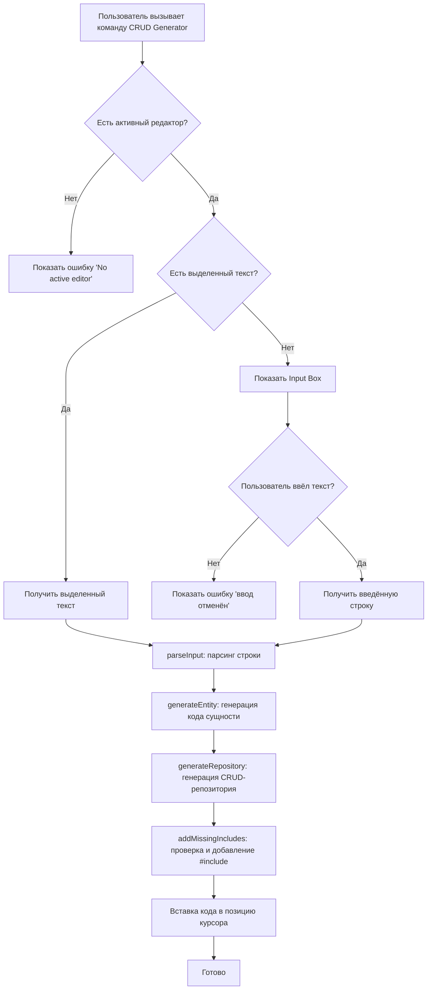

# Генератор c++ CRUD классов

Плагин для VS Code, который автоматически генерирует C++ классы и CRUD-репозитории по текстовому описанию сущности.

## Возможности

- Генерация C++ классов с getters/setters
- Генерация классов-репозиториев с CRUD-методами (создание, чтение, обновление, удаление)
- Автоматическое добавление необходимых `#include` директив (`<vector>`, `<string>`)
- Поддерживает сущности: `class`, `struct`

## Установка

1. Скачайте файл `crud-generator-0.0.1.vsix`
2. Откройте VS Code
3. Нажмите `Ctrl+Shift+P` и введите `Extensions: Install from VSIX`
4. Выберите скачанный файл
5. Перезагрузите VS Code

## Использование

1. Откройте или создайте `.cpp` файл
2. Напишите описание сущности в формате:
```сpp
ИмяСущности поле1:тип1 поле2:тип2 [class|struct]
```
3. Выделите эту строку мышкой
4. Нажмите `Ctrl+Shift+P` и выберите команду `Generate C++ CRUD`
5. Сгенерированный код появится на месте выделенной строки

Если строка не выделена, плагин предложит ввести описание через всплывающее окно.

## Формат описания сущности

```cpp
ИмяКласса имяПоля:типПоля ... class/struct # Сущность по умолчанию: class
```
где:
- **ИмяКласса** — название генерируемого класса (например, `User`, `Product`)
- **имяПоля:типПоля** — поля класса и их типы
- **class/struct** — тип сущности (необязательно)

### Поддерживаемые типы

| Тип в описании | Тип в C++ |
|----------------|-----------|
| `string`       | `std::string` |
| `boolean`      | `bool` |
| `int`          | `int` |
| `double`       | `double` |
| другие         | используется как есть |

## Примеры

### Пример 1: Класс User

**Вход:**
```cpp
User name:string age:int email:string
```

**Выход:**
```cpp
#include <vector>
#include <string>

class User {
private:
    std::string name;
    int age;
    std::string email;

public:
    std::string getName() const {
        return name;
    }
    void setName(std::string newName) {
        name = newName;
    }
    int getAge() const {
        return age;
    }
    void setAge(int newAge) {
        age = newAge;
    }
    std::string getEmail() const {
        return email;
    }
    void setEmail(std::string newEmail) {
        email = newEmail;
    }
};

class UserRepository {
private:
    std::vector<User> items;

public:
    void create(const User& item) {
        items.push_back(item);
    }

    User* readByName(std::string name) {
        for (size_t i = 0; i < items.size(); i++) {
            if (items[i].getName() == name) {
                return &items[i];
            }
        }
        return nullptr;
    }

    std::vector<User> readAll() const {
        return items;
    }
    void updateByName(std::string name, const User& newItem) {
        for (size_t i = 0; i < items.size(); i++) {
            if (items[i].getName() == name) {
                items[i] = newItem;
                return;
            }
        }
    }

    void deleteByName(std::string name) {
        for (size_t i = 0; i < items.size(); i++) {
            if (items[i].getName() == name) {
                items.erase(items.begin() + i);
                return;
            }
        }
    }
};
```

### Пример 2: Структура Point

**Вход:**
```cpp
Point x:int y:int z:int struct
```

**Выход:**
```cpp
struct Point {
public:
    int x;
    int y;
    int z;
};

class PointRepository {
private:
    std::vector<Point> items;

public:
    void create(const Point& item) {
        items.push_back(item);
    }

    Point* readByX(int x) {
        for (size_t i = 0; i < items.size(); i++) {
                        if (items[i].x == x) {
                return &items[i];
            }
        }
        return nullptr;
    }

    std::vector<Point> readAll() const {
        return items;
    }

    void updateByX(int x, const Point& newItem) {
        for (size_t i = 0; i < items.size(); i++) {
            if (items[i].x == x) {
                items[i] = newItem;
                return;
            }
        }
    }
    void deleteByX(int x) {
        for (size_t i = 0; i < items.size(); i++) {
            if (items[i].x == x) {
                items.erase(items.begin() + i);
                return;
            }
        }
    }
};
```

## Как работает поиск в репозитории

Методы поиска (`readBy...`, `updateBy...`, `deleteBy...`) всегда используют **первое поле** сущности как ключ:

- `User name:string age:int` → поиск по `name` → `readByName`, `updateByName`, `deleteByName`
- `Product id:int price:double` → поиск по `id` → `readById`, `updateById`, `deleteById`
- `Point x:int y:int` → поиск по `x` → `readByX`, `updateByX`, `deleteByX`

## Архитектура и блок-схема работы плагина



**Плагин реализовал Башкин Владимир Юрьевич, М3116**